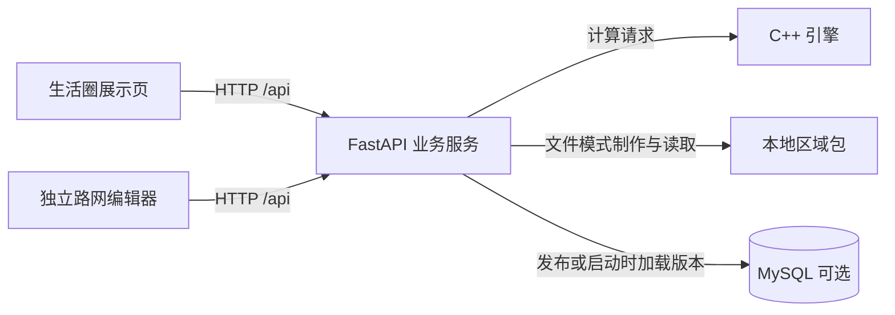

# Vision China Terminal（VCT）


Vision China Terminal（中国观察终端）是一个面向社区步行可达性分析的 Web 项目。选择区域和起点后，可以查看 15 分钟步行范围、周边生活设施、参考路线和服务覆盖提示。项目内置上海新江湾城区域包，支持制作自己的区域数据，并通过 MySQL 管理完整区域包的发布版本。

项目由生活圈展示页、独立路网编辑器、Python 业务 API 和 C++ 计算引擎组成。主站用于分析与展示，编辑器用于制作路网，前后端可以分别构建和部署。

## 计算模式

| 模式 | 数据与计算方式 | 使用条件 |
| --- | --- | --- |
| 在线计算 | 使用百度步行路线采样、插值与等时圈提取，查询地点和参考路线 | 需要网络、地图 AK 和可用 API 配额 |
| C++ 路网模式（合成模拟） | 在区域包的步行图上计算可达范围与设施覆盖，使用显式节点、路段、过街和等待参数 | 范围计算使用本地模型；在线底图和在线地点刷新另需网络 |

路网模型和设施清单的完整性会影响结果。未经核实的入口、通行关系和设施数据不能直接作为真实生活服务缺失的证明。算法说明见 [在线计算](backend/README.md) 和 [C++ 路网计算](cpp-engine/README.md)。

## 架构与目录



浏览器只访问 HTTP API，数据库凭据保留在后端。默认引擎通过子进程调用；源码还提供可选 gRPC 传输，当前 Docker 后端仍使用 C++ CLI，没有拆成独立 RPC 容器。

| 目录／文件 | 用途 |
| --- | --- |
| `frontend/` | Vue 主站与独立编辑器，分别构建 |
| `backend/app/` | API、区域包、发布仓储及计算编排 |
| `backend/sql/` | MySQL 首版建表 SQL |
| `cpp-engine/` | C++20 路网计算与可选 RPC 服务 |
| `data/regions/` | 本地完整区域包及编辑源文件 |
| `deploy/` | 独立前端、后端、MySQL 的 Compose 配置 |
| `contracts/` | Python 与 C++ 的数据契约 |
| `start-demo.bat` | Windows 本地启停入口 |

## Windows 快速开始

以下命令在仓库根目录的 PowerShell 中执行。准备 Python 3.12+、Node.js 22.12+ 的 22.x 版本，以及支持 C++20 的编译器；使用 CMake 时需 3.20+ 和匹配的工具链。首次安装依赖需要联网。

### 1. 安装依赖

```powershell
python -m venv .venv
.\.venv\Scripts\python.exe -m pip install -r backend/requirements.txt
npm.cmd --prefix frontend ci
```

### 2. 创建配置

已有配置文件时保留原内容，不重复覆盖：

```powershell
if (-not (Test-Path -LiteralPath .env)) {
    Copy-Item .env.windows.example .env
}
if (-not (Test-Path -LiteralPath frontend/.env.local)) {
    Copy-Item frontend/.env.example frontend/.env.local
}
```

| 文件 | 配置 | 用途 |
| --- | --- | --- |
| 根 `.env` | `BAIDU_SERVER_AK` | 服务端在线路线与地点查询 |
| `frontend/.env.local` | `VITE_BAIDU_BROWSER_AK` | 百度底图与编辑器地点定位 |
| 根 `.env` | `REGION_ID` | 默认区域，初始为 `shanghai-new-jiangwan` |
| 根 `.env` | `REGION_STORAGE_BACKEND=file` | 本地编辑与文件模式读取 |

地图 AK 由使用者自行申请。浏览器 AK 需允许实际使用的本机来源；服务端 AK 和数据库密码不要放进 `VITE_` 变量。AK 留空时仍可使用包内地图、路网与地点快照体验合成模拟。

### 3. 启动与停止

双击 `start-demo.bat`，或执行：

```powershell
.\start-demo.bat start
.\start-demo.bat status
```

| 服务 | 默认地址 |
| --- | --- |
| 生活圈主站 | [http://127.0.0.1:5173/](http://127.0.0.1:5173/) |
| 独立路网编辑器 | [http://127.0.0.1:5174/](http://127.0.0.1:5174/) |
| 后端 API 文档 | [http://127.0.0.1:8000/docs](http://127.0.0.1:8000/docs) |

启动器会按需构建引擎，启动共用后端和两个独立前端进程，并执行既有的计算链路检查。双击 BAT 只自动打开主站，编辑器手动访问；主站已移除编辑入口，旧 `?mode=editor` 地址不再打开编辑器。

```powershell
.\start-demo.bat restart
.\start-demo.bat stop
# 可选：改用其他编辑器端口
.\start-demo.bat restart -EditorPort 5274
```

`stop` 会停止本启动器登记的三个进程。修改后端配置后使用 `restart`；端口冲突、日志和其他参数见 [Windows 启动说明](docs/windows-demo-launcher.md)。以上是脚本的使用说明，本次改造未执行启动或测试。

## 路网编辑器

编辑器按工作用途组织工具，右侧只展开当前功能需要的面板：

| 类别 | 统一入口 |
| --- | --- |
| 基础工具 | 选择与属性、绘制道路、调整结构 |
| 进阶工具 | 检查与优化、自动建图、区域与发布 |
| 常用操作 | 保存本地、撤销、重做、图层 |

可以创建区域、绘制和修正道路、检查路径、审阅局部精化建议、从已有 OSM 道路源图生成路口草案，或框选子区域打包。路网生成与底图轮廓生成分别预览、采纳；空白区域尚不支持一键下载 OSM 并生成完整步行路网。

保存和发布是两个动作：

1. **保存本地**：校验并更新区域包，保留修改前备份。
2. **进阶 → 区域与发布 → 发布已保存版本**：将完整区域包导入 MySQL 并切换发布指针，前提是已配置数据库。

存在未保存修改或未处理的生成预览时，先处理并保存。旧 `5173` 端口的浏览器草稿不会自动迁移到 `5174`；切换前应在旧编辑页恢复并保存，或导出完整路网 JSON。已保存到后端的区域继续共用。详见 [编辑器操作与发布](docs/network-editor.md)。

## MySQL 初始化、构建与发布

MySQL 是可选组件，默认文件模式无需数据库。首版完整保存区域包版本，包含清单、路网、POI、标定、底图与编辑源文件；没有将节点和路段拆成关系表。

| 模式 | 配置 | 行为 |
| --- | --- | --- |
| 本地制作 | `APP_ENV=development`、`REGION_STORAGE_BACKEND=file` | 编辑本地文件，也可通过按钮发布到 MySQL |
| 数据库展示 | `REGION_STORAGE_BACKEND=mysql` | 启动时加载已发布版本，关闭编辑器 API |

### 1. 创建数据库与业务账号

选择下面一种方式。创建数据库和账号需要数据库管理权限；项目的 `init` 命令只建表，不创建数据库或用户。

**方式 A：使用项目提供的 MySQL 8.4 容器。** 先准备 Docker Desktop 的 Linux containers 和 Docker Compose 2.24+，创建配置：

```powershell
if (-not (Test-Path -LiteralPath .env.mysql)) {
    Copy-Item .env.mysql.example .env.mysql
}
```

在 `.env.mysql` 填写 `MYSQL_PASSWORD` 和 `MYSQL_ROOT_PASSWORD`，保留默认数据库 `livingcircle` 与业务账号 `livingcircle`，或统一改成自己的值。共享网络已存在时直接复用：

```powershell
docker network create vct
# Windows 编辑器需要连接数据库时，附加仅本机开放端口的覆盖配置。
docker compose --env-file .env.mysql -p vct-mysql -f deploy/mysql.compose.yml -f deploy/mysql.local.compose.yml up -d
```

首次启动空数据卷时，MySQL 镜像根据这些变量创建数据库和业务账号。等待数据库初始化完成后再建表；已有数据卷不会因为修改环境文件而重设账号密码。只在 Docker 内部使用数据库时，省略 `-f deploy/mysql.local.compose.yml`，不发布主机端口。

**方式 B：使用已有 MySQL 8.4。** 例如编辑服务通过本机 TCP 连接数据库，可由管理员在 MySQL 客户端执行下列 SQL，先替换密码占位文字：

```sql
CREATE DATABASE livingcircle
  CHARACTER SET utf8mb4 COLLATE utf8mb4_bin;
CREATE USER 'livingcircle'@'127.0.0.1'
  IDENTIFIED BY '替换为你自己的数据库密码';
GRANT SELECT, INSERT, UPDATE, CREATE, REFERENCES
  ON livingcircle.* TO 'livingcircle'@'127.0.0.1';
```

这是本机来源账号示例；若应用来自容器或其他主机，账号的 Host 应匹配实际允许的客户端来源，`MYSQL_HOST` 则填写数据库地址。已有账号按需补充授权，不重复创建。上述权限覆盖当前首版建表、读取和发布操作；账号与授权语义见 [MySQL 官方说明](https://dev.mysql.com/doc/refman/8.4/en/creating-accounts.html)。已有实例还需由管理员配置足够的 `max_allowed_packet`，本项目 Compose 使用 `128M`。

### 2. 配置本地编辑后端并初始化表

根 `.env` 保持文件模式，填写业务账号连接信息。使用方式 A 的本机端口映射时，示例为：

```dotenv
APP_ENV=development
REGION_STORAGE_BACKEND=file
MYSQL_HOST=127.0.0.1
MYSQL_PORT=3306
MYSQL_DATABASE=livingcircle
MYSQL_USER=livingcircle
MYSQL_PASSWORD=替换为上一步业务账号的密码
```

Windows 进程不能用 Docker 内部服务名 `mysql` 连接数据库。若配置了其他 `MYSQL_LOCAL_PORT`，这里的 `MYSQL_PORT` 也要对应修改。此处填写业务账号密码，不是 `MYSQL_ROOT_PASSWORD`。

```powershell
.\.venv\Scripts\python.exe -m pip install -r backend/requirements-mysql.txt
Push-Location backend
try {
    ..\.venv\Scripts\python.exe -m app.region_store_cli init
} finally {
    Pop-Location
}
```

初始化创建三张表：`regions` 保存发布指针，`region_versions` 保存版本与原始清单，`region_files` 保存文件原字节和摘要。API 启动和编辑器发布不会隐式建表。

### 3. 导入与发布区域包

重启本地后端，在编辑器中保存区域，再点击“发布已保存版本”。也可以通过命令导入指定目录：

```powershell
Push-Location backend
try {
    ..\.venv\Scripts\python.exe -m app.region_store_cli import ../data/regions/shanghai-new-jiangwan --publish
    ..\.venv\Scripts\python.exe -m app.region_store_cli list
} finally {
    Pop-Location
}
```

保存返回的 `version_id`。相同内容重复导入会复用版本，内容改变则生成新的内容版本；导入和可选发布在同一事务中提交。省略 `--publish` 可只导入，之后用 `publish REGION_ID VERSION_ID` 发布。`export REGION_ID VERSION_ID DIRECTORY` 可导出到一个尚不存在的目录，详见 [版本导出与回退](docs/mysql-region-storage.md#导出与回退)。

编辑器显示“配置已具备”只说明服务端参数和驱动存在，不代表数据库在线或表已初始化。发布失败保留此前的本地保存，不自动重试。

### 4. 构建并运行 MySQL 展示后端

`.env.mysql.example` 默认使用容器内部地址 `MYSQL_HOST=mysql`，以及 `REGION_STORAGE_BACKEND=mysql`、`BACKEND_IMAGE=vct-backend:mysql`、`BACKEND_ENV_FILE=../.env.mysql`。使用同一 Docker 网络时保留这些值；连接外部 MySQL 时改为容器可访问的数据库地址与账号。

```powershell
docker build --build-arg WITH_MYSQL=true -t vct-backend:mysql .
```

如果未通过本地 Python 完成建表和首次导入，可使用镜像中的管理命令完成这两步：

```powershell
docker compose --env-file .env.mysql -p vct-backend -f deploy/backend.compose.yml run --rm --no-deps backend python -m app.region_store_cli init
docker compose --env-file .env.mysql -p vct-backend -f deploy/backend.compose.yml run --rm --no-deps backend python -m app.region_store_cli import /app/data/regions/shanghai-new-jiangwan --publish
```

默认区域已有发布版本后再启动展示后端：

```powershell
docker compose --env-file .env.mysql -p vct-backend -f deploy/backend.compose.yml up -d
```

后端默认映射到本机 `8001`。`--env-file` 为 Compose 提供替换变量，`BACKEND_ENV_FILE` 指定注入后端容器的配置，两者用途不同。此服务不会自动继承另一份根 `.env` 的全部配置，需要的服务端地图与助手配置应加入 `.env.mysql`。

新版本发布后，已经运行的 MySQL 展示后端仍使用旧快照，需要显式重启：

```powershell
docker compose --env-file .env.mysql -p vct-backend -f deploy/backend.compose.yml restart backend
```

每个服务实例在启动时为每个已发布区域生成一份临时文件快照，现有计算流程读取该快照，运行期间不逐边查询 SQL。启动加载失败不回退仓库旧图；发布不会自动热切换。文件模式编辑服务继续读本地包，不需要改成 MySQL 模式。

### 存储边界

- 单文件上限为 **32 MiB**；Compose 的 `max_allowed_packet` 为 **128 MiB**，列类型的理论容量不代表项目输入上限。
- 历史版本完整保留，尚无跨版本文件去重或自动清理；运行时仍需要临时磁盘快照。
- MySQL 保存区域包，不持久化当前分析任务或 Agent 会话；重启后不能继续查询原进程内任务。
- 数据库账号和密码仅配置在后端。完整配置、操作与回退说明见 [MySQL 区域包存储](docs/mysql-region-storage.md)。

## Docker 前后端部署

前端镜像只包含生活圈主站；独立编辑器目前使用 Windows／Vite 工作流，没有单独的编辑器 Docker 服务。后端镜像包含 FastAPI 和 C++ CLI，MySQL 驱动通过 `WITH_MYSQL=true` 选择安装。

### 本机文件模式演示

从 [.env.example](.env.example) 创建或补充 Docker 使用的根 `.env`，填写 `VITE_BAIDU_BROWSER_AK`、`BAIDU_SERVER_AK` 和 `REGION_ID`。这与 Windows 的配置路径用途不同，切换方式时按样例调整，不覆盖已有密钥。

```powershell
docker compose up --build -d
docker compose logs -f frontend backend
```

默认访问 [http://localhost:8000/](http://localhost:8000/)。它与 Windows 后端默认端口相同，选择一种运行方式，或修改 Docker 的 `LOCAL_PORT`。`docker compose down` 停止本组容器，区域数据仍保存在绑定的 `./data` 目录。

### 连接独立 MySQL 展示后端

完成上一节的 `vct-backend` 部署后，在 `.env.mysql` 中增加前端使用的设置：

```dotenv
VITE_BAIDU_BROWSER_AK=替换为你的浏览器AK
FRONTEND_IMAGE=vct-frontend:local
API_UPSTREAM=http://backend:8000
LOCAL_PORT=8080
```

仅使用包内地图时浏览器 AK 可留空。随后分别构建并发布前端：

```powershell
docker compose --env-file .env.mysql build frontend
docker compose --env-file .env.mysql -p vct-frontend -f deploy/frontend.compose.yml up -d
```

访问 [http://localhost:8080/](http://localhost:8080/)。前端 Nginx 通过同一 Docker 网络访问后端，浏览器仍请求相对地址 `/api`。默认端口只绑定本机回环；域名、远程入口和 HTTPS 需另行配置，并不因容器启动而自动发布到公网。

前后端可以分别构建、更新和重建。只改后端地址时调整 `API_UPSTREAM` 并重建前端容器，无需重建 Vue；修改浏览器 AK 时需要重建前端制品。详细步骤见 [前后端独立部署](docs/frontend-backend-deployment.md)。

## 可选生活圈助手

助手默认关闭。完成当前起点的生活圈分析后，可询问“最近的医院怎么走”“这两家哪家步行更快”，由助手调用现有地点和路线工具。候选不完整时会说明比较范围。

在实际加载的后端 `.env` 中配置：

```dotenv
AGENT_ENABLED=true
AGENT_API_BASE_URL=https://your-api.example/v1
AGENT_API_KEY=替换为你的模型API密钥
AGENT_MODEL=替换为服务商支持的模型名称
```

服务需支持 Responses API、函数工具调用、`store:false` 和 `reasoning.encrypted_content`；后端会在根地址后追加 `/responses`。模型密钥与地图 AK 独立，均不进入前端。超时、并发和调用次数沿用默认值，配置与接口见 [生活圈 Agent 说明](docs/life-circle-agent.md)。

## 数据、文档与当前状态

迁移区域时保留完整的 `data/regions/<id>/`，ZIP 包先解压再使用。迁移到另一台电脑后重新安装依赖并配置自己的密钥，不复制旧虚拟环境和前端依赖目录。

- [区域包格式、制作与打包](docs/region-packages.md)
- [路网编辑器与工具栏](docs/network-editor.md)
- [Windows 启动参数](docs/windows-demo-launcher.md)
- [MySQL 初始化、发布与回退](docs/mysql-region-storage.md)
- [前后端独立部署](docs/frontend-backend-deployment.md)
- [在线算法与后端接口](backend/README.md)
- [C++ 算法、构建与可选 gRPC](cpp-engine/README.md)
- [Python ↔ C++ 数据契约](contracts/engine-v2.README.md)

本次编辑器拆分、工具栏整理与 MySQL 接入已完成源码、配置和文档静态审阅，尚未执行新增功能的数据库连接、导入发布、镜像构建或运行测试。本文命令是使用说明，不是本次运行验收记录；没有性能提升或容量上限的实测结论。Redis 与 C++ 直接加载数据库版本仍为后续工作。

项目代码采用 [MIT License](LICENSE)。OSM 衍生区域资源须保留 OpenStreetMap contributors 署名及 ODbL 来源说明；百度地图服务和数据另遵循其使用条件。
