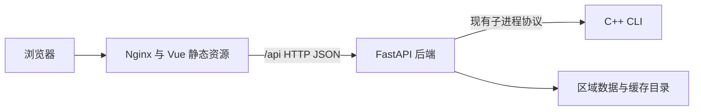

# 前后端独立部署

更新日期：2026-10-30。本文说明 Vue 前端与 FastAPI 后端的独立构建、运行和发布，默认使用文件数据源。C++ CLI 暂时随后端镜像部署；后续接入的可选数据库配置见 [MySQL 区域包版本存储](mysql-region-storage.md)。Redis 和独立 C++ RPC 服务尚未迁移。

当前仅完成源码、配置与文档的静态审阅，没有执行镜像构建、Compose 启动、测试或浏览器验证。下文命令是后续操作说明，尚未作为运行证据执行。域名、证书和公网入口也尚未配置。

## 架构与制品



| 制品 | 构建入口与上下文 | 运行内容 |
| --- | --- | --- |
| 前端镜像 | `frontend/Dockerfile`，上下文为 `frontend/` | Nginx 与 Vue 构建产物，无 Python、C++ 或服务器密钥 |
| 后端镜像 | 根 `Dockerfile`，上下文为仓库根目录 | FastAPI、Python 依赖、Release C++ CLI 和区域数据，无 Vue 构建产物 |

前后端分别构建、发布和重建容器。前端继续请求相对地址 `/api/v1/...`，Nginx 在服务端转发请求，浏览器不用知道后端容器名或内网地址。同一个域名可以承载这两个独立部署的服务，不需要先改成两个域名或增加跨域配置。

FastAPI 已不再挂载前端静态目录，`STATIC_DIR` 不再控制页面托管。直接访问后端 `/` 得到 404 属于这一接口边界；API 和 `/docs`、`/redoc`、`/openapi.json` 继续由后端提供，前端 Nginx 也会转发这些文档地址。

## 配置归属

| 配置 | 生效位置 | 说明 |
| --- | --- | --- |
| `VITE_BAIDU_BROWSER_AK` | 前端构建时 | 浏览器地图 AK，修改后需要重建前端镜像 |
| `API_UPSTREAM` | 前端容器启动时 | 后端 HTTP origin，默认 `http://backend:8000`；只含协议、主机及可选端口，不含路径或末尾 `/` |
| `BAIDU_SERVER_AK`、`AGENT_*` | 后端容器启动时 | 服务端配置，不传入前端镜像或前端运行环境 |
| `REGION_ID` 和区域路径 | 后端容器启动时 | 选择后端数据，不要求重建前端 |
| `FRONTEND_IMAGE`、`BACKEND_IMAGE` | Compose 读取配置时 | 选择独立镜像版本，默认 `vct-frontend:local`、`vct-backend:local` |

后端只从环境变量、仓库根 `.env` 或 `backend/.env` 读取服务器密钥，不再读取 `frontend/.env.local`，也不再兼容 `VITE_BAIDU_SERVER_AK`。旧配置若仅将服务器密钥放在前端目录，需要自行迁移为后端配置中的 `BAIDU_SERVER_AK`；本次没有读取或修改真实密钥文件。根 `.dockerignore` 排除前端目录，后端构建不再需要任何前端文件。

`API_UPSTREAM` 是 **Nginx 容器能够访问的地址**。`http://127.0.0.1:8000` 在前端容器里指前端容器自身，不能用来表示另一个容器或宿主机。组合部署使用 `http://backend:8000`；跨主机部署可使用可达的后端私网地址，例如 `http://10.0.0.20:8001`。该示例地址需要替换成真实环境信息。

前端镜像通过启动模板写入代理目标，因此只改后端地址时无需重建 Vue。Nginx 使用 Docker DNS 解析目标域名；同主机容器通过用户自定义网络互相发现。代理配置不在启动时强制连接后端，前端可以先启动；后端尚未就绪时 API 请求会失败，静态页面仍可加载。后端容器更新 IP 后，后续解析可取得新地址，更新期间的在途请求仍可能失败。

## 本机组合部署

以下命令在仓库根目录的 PowerShell 中执行。保留已有 `.env`；文件不存在时才复制样例：

```powershell
if (-not (Test-Path -LiteralPath .env)) {
    Copy-Item .env.example .env
}
docker compose up --build -d
docker compose ps
```

根 `docker-compose.yml` 同时描述 `frontend` 与 `backend`。前端绑定本机 `127.0.0.1:${LOCAL_PORT:-8000}`，后端只在 Compose 内部网络提供 8000 端口；区域数据与缓存目录只挂载到后端。访问 [前端页面](http://localhost:8000/)、[后端 API 文档](http://localhost:8000/docs)或[引擎健康接口](http://localhost:8000/api/v1/health)，修改 `LOCAL_PORT` 后使用相应端口。

该组合配置保留本机编辑 API 所需的开发环境设置，但默认前端镜像只构建生活圈主站，不再包含编辑器入口或页面。独立编辑器由 Windows BAT 在另一端口启动，当前没有另建编辑器 Docker 服务。Nginx 转发浏览器原始 Host，后端沿用已有的本地访问检查；未放宽为任意远程编辑。独立生产配置的编辑器状态见下一节。

从旧版单 `app` 服务迁移时，改用：

```powershell
docker compose up --build -d --remove-orphans
```

`--remove-orphans` 会移除同一 Compose 项目中不再定义的容器，包括占用旧入口端口的 `app`，不会删除绑定的 `./data`。旧服务中的在途计算和内存任务记录不会迁移到新容器；此次存储仍采用原来的区域文件和缓存。

只更新前端或只更新后端：

```powershell
docker compose up -d --build --no-deps frontend
docker compose up -d --build --no-deps backend
```

按实际修改选择其中一条。前端更新不重新构建后端或 C++；后端更新不重新构建 Vue。后端重建时页面容器继续运行，但计算接口会经历不可用窗口。

## 分别发布前端与后端

独立发布配置使用镜像，不在部署时构建：

- `deploy/frontend.compose.yml` 只启动前端。
- `deploy/backend.compose.yml` 只启动后端，默认 `APP_ENV=production`，关闭编辑器。

先在构建机器生成两个有明确版本的镜像，下面使用示例标签 `20261030`。浏览器 AK 的参数值需自行填写；该值允许出现在前端，服务器 AK 不应传给构建命令。

```powershell
docker build --build-arg VITE_BAIDU_BROWSER_AK=替换为浏览器AK -t vct-frontend:20261030 ./frontend
docker build -t vct-backend:20261030 .
```

构建机器只修改前端时，仅需执行第一条命令；后端同理。部署到另一台机器时，将对应镜像推送到自己选定的镜像仓库并在部署机拉取，或通过 `docker save` / `docker load` 搬运。本次没有代为推送镜像或连接服务器。

同一主机的两个 Compose 项目共享一个已存在的网络，首次创建一次：

```powershell
docker network create vct
```

然后分别发布，命令仍从仓库根目录执行：

```powershell
$env:FRONTEND_IMAGE = 'vct-frontend:20261030'
$env:BACKEND_IMAGE = 'vct-backend:20261030'
docker compose --env-file .env -p vct-backend -f deploy/backend.compose.yml up -d
docker compose --env-file .env -p vct-frontend -f deploy/frontend.compose.yml up -d
```

这两份配置没有互相启动的依赖。可以单独发布任意一侧，前端仍通过网络中的 `backend` 名称访问后端。默认前端入口为本机 8000 端口，独立后端接口为本机 8001 端口。

独立配置的参数如下：

| 变量 | 默认值 | 说明 |
| --- | --- | --- |
| `DEPLOY_NETWORK` | `vct` | 两份配置共同使用的已有 Docker 网络 |
| `LOCAL_PORT` | `8000` | 前端宿主机端口 |
| `FRONTEND_BIND_HOST` | `127.0.0.1` | 前端宿主机绑定地址 |
| `BACKEND_PORT` | `8001` | 后端宿主机端口 |
| `BACKEND_BIND_HOST` | `127.0.0.1` | 后端宿主机绑定地址 |
| `BACKEND_ENV_FILE` | `../.env` | 后端运行配置文件；相对路径以 `deploy/` 为基准 |
| `DATA_DIR` | `../data` | 后端数据目录；相对路径以 `deploy/` 为基准 |

命令中的 `--env-file .env` 供 Compose 插值，路径以当前工作目录为基准；它不会自动把全部变量注入前端容器。后端配置中的 `env_file` 才将后端运行配置注入后端。已有 `.env` 中的 Windows 本地路径应按容器内 `/app/...` 路径调整；不要覆盖原配置来凑一份空白文件。

跨主机时，每台主机各自准备本地的 Docker 网络，Docker 网络本身不会跨机器延伸。后端主机将 `BACKEND_BIND_HOST` 设为实际私网接口地址，前端将 `API_UPSTREAM` 指向该地址及发布端口。本轮上游方案为内网 HTTP；没有配置或验证上游 TLS。发布到域名时，再为前端入口配置实际监听地址、DNS 和 HTTPS；当前交付是 HTTP 部署骨架，不代表已经公网发布。

## 独立升级与回退

生产发布使用新镜像标签，而不是覆盖旧标签。先准备新镜像，再只更新对应服务：

```powershell
$env:FRONTEND_IMAGE = 'vct-frontend:20261030-r2'
docker compose --env-file .env -p vct-frontend -f deploy/frontend.compose.yml up -d
```

回退前端只需重新选择旧镜像：

```powershell
$env:FRONTEND_IMAGE = 'vct-frontend:20261030'
docker compose --env-file .env -p vct-frontend -f deploy/frontend.compose.yml up -d
```

后端使用同样方式切换 `BACKEND_IMAGE`，执行 `vct-backend` 对应命令。后端镜像回退不会自动回退挂载的数据目录；后端代码版本与区域数据必须兼容。本文默认文件模式不涉及数据库迁移；选择 MySQL 时还须按其文档管理区域版本。两种模式都没有任务持久化，后端容器重建后不能继续查询原进程内的任务记录。

前后端独立发布仍依赖兼容的 API 契约。此次保留现有 `/api/v1` 路径与数据字段，后续增加字段时应避免同时要求两边立即升级。

## 代理、健康状态与开发方式

Nginx 将 `/api` 请求和 API 文档请求转发到后端，保留路径与查询参数；API 的 404 不回退成前端 HTML。前端页面使用 SPA 回退，构建资产缺失时返回 404。页面入口不按长期静态文件缓存，带构建哈希的资源可长期缓存。

默认代理请求体上限为 32 MiB，读取上游响应的空闲超时为 120 秒。它们属于部署层限制，不会修改后端计算预算；增加 Agent 等后端超时时，应同步检查代理等待设置。请求体超过限制会由 Nginx 返回 413。当前后端接口仍使用既有 HTTP 任务受理与查询方式，本次没有新增流式接口。

前端容器健康检查只访问自身页面，不把后端故障变成前端容器不健康。后端沿用引擎与默认区域的健康检查。因此查看前端 `healthy`，只能确认页面可提供；完整功能还需后端及计算引擎可用。

Windows 的 `start-demo.bat` / `start-demo.ps1` 分别启动主站 Vite（5173）、编辑器 Vite（5174）和共用 Python API（8000），主站无编辑入口。编辑器可通过 `-EditorPort` 指定其他端口。手动开发使用 `npm --prefix frontend run dev` / `npm --prefix frontend run dev:editor`，`API_UPSTREAM` 可配置开发代理目标，默认 `http://127.0.0.1:8000`，无需以 `VITE_` 变量暴露给浏览器。

主站仍以 `npm --prefix frontend run build` 输出 `frontend/dist/index.html`。独立编辑器用 `npm --prefix frontend run build:editor` 输出 `frontend/dist-editor/editor.html`，可用 `npm --prefix frontend run preview:editor` 预览根入口；部署到静态服务器时需将根入口指向 `editor.html`，并另配 `/api` 代理。Vite preview 仅用于本地预览，不替代生产 Nginx 配置。以上新增命令本轮均未执行。

本轮运行证据仍为空：未执行上述命令、Docker／Nginx 校验、镜像构建、程序或浏览器访问。后续按用户明确要求再取得启动、API 转发、编辑器兼容、独立升级及回退的运行证据；静态审阅不代表这些行为已通过运行验收。

配置依据：Nginx 的变量代理与超时语义见[官方代理模块说明](https://nginx.org/en/docs/http/ngx_http_proxy_module.html)；启动时只替换指定环境变量的行为见[官方容器模板脚本](https://github.com/nginx/docker-nginx/blob/master/entrypoint/20-envsubst-on-templates.sh)；服务名与外部网络的用法见[Docker Compose 网络说明](https://docs.docker.com/compose/how-tos/networking/)。这些资料核对不替代本项目运行验证。
